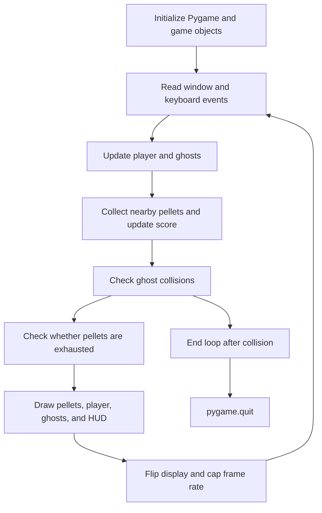

# Pac-Man Game — Python Arcade Prototype

### A compact Pygame exercise in input, movement, collision detection, and rendering

A **Python and Pygame arcade prototype** featuring a keyboard-controlled player, collectible pellets, moving ghosts, score display, and collision-based game over. Graphics are drawn with circles and polygons, so no external sprite or audio assets are required.

The project brings several foundational software concepts into one visible loop: process events, update object state, resolve interactions, and render the next frame.

[Game source on `master`](https://github.com/FaiazS/Pac-Man-Game/blob/master/Agentic%20AI%20Pioneer%20Program%20Analytics%20Vidhya/Building%20with%20WindSurf/pac_man_game.py) · [Dependencies](https://github.com/FaiazS/Pac-Man-Game/blob/master/Agentic%20AI%20Pioneer%20Program%20Analytics%20Vidhya/Building%20with%20WindSurf/requirements.txt)

> **Branch guide:** The default `main` branch contains the README. Implementation is on **`master`**, under `Agentic AI Pioneer Program Analytics Vidhya/Building with WindSurf/`. This is a Pac-Man-inspired open-field prototype, not a full recreation of the original maze game. The game was not executed for this documentation.

---

## Gameplay implemented

| Feature | Current behavior |
|---|---|
| Window | 800 × 600 pixels |
| Player | Yellow circle with a timer-controlled polygon animation |
| Controls | Arrow keys change movement direction |
| Movement | Continuous movement in the last selected direction, clamped at screen boundaries |
| Pellets | White dots placed by a grid-based generator |
| Scoring | 10 points per collected pellet |
| Enemies | Colored circles that periodically choose random targets |
| Game over | Ghost collision prints the score and ends the loop |
| Display | Score, level counter, and temporary level text |
| Timing | Main loop capped at a target of 20 frames per second |

There are no maze walls, power pellets, edible ghosts, lives, pause controls, restart screen, audio, or saved high scores in the reviewed code.

## Why this project is useful

A small game makes state and control-flow decisions tangible. A direction changes coordinates; coordinates determine collisions; collisions change score or end the session; rendering exposes the current state.

The portfolio value is the integration of those responsibilities—not a claim of commercial game quality or advanced enemy AI.

## Code organization

| Component | Responsibility |
|---|---|
| `Player` | Position, direction, score, movement, animation state, and drawing |
| `Ghost` | Position, random-target selection, timed movement, and drawing |
| `Level` | Ghost count configuration, spawn positions, and pellet generation |
| `initialize_game()` | Creates a player, level, ghosts, and pellets |
| `main()` | Event handling, updates, collisions, progression, rendering, and shutdown |



The main loop completes its remaining work after setting `running=False`; it exits on the next loop condition. Rendering is immediate-mode drawing, not a scene graph or asset pipeline.

## Movement and collision mechanics

### Player

The player starts at `(160, 160)`, initially moving right, and advances 32 pixels each update. Its coordinates are clamped to the window rather than wrapping around its edges.

Movement depends on update count, not elapsed-time scaling. If the achieved frame rate drops, movement slows accordingly. The 600-pixel height is not divisible by the 32-pixel grid size, so clamping can place the player off the normal grid near the bottom edge.

### Ghosts

Ghosts initially have no target. They select a random target every 30 updates and move toward it every five updates after a target exists. At the target 20 FPS, those intervals are approximately 1.5 seconds and 0.25 seconds respectively.

Each movement can change both X and Y, producing diagonal steps. Target selection is random; ghosts do not chase the player, search a maze, or coordinate tactics. Randomness is not seeded for reproducible sessions.

### Collisions

Pellet collection and ghost collision use coordinate-distance thresholds on both axes:

```text
abs(other_x − player_x) < GRID_SIZE
and
abs(other_y − player_y) < GRID_SIZE
```

This is a simple axis-aligned proximity test, not exact circle collision or continuous collision detection. Pellets are removed while iterating over a copy of their list, avoiding direct mutation of the iterated list.

## Level progression: intended design and current behavior

`Level` defines its ghost count as:

```python
min(4, level_number + 1)
```

That supports two ghosts at level 1, three at level 2, and four from level 3 onward—if the current level is passed into construction.

However, `initialize_game()` always creates `Level(1)`. When pellets are exhausted, `main()` increments the displayed counter but calls that same initializer. Consequently:

- The HUD level number increases.
- The actual level object remains level 1.
- Ghost count remains two.
- The newly constructed player resets score to zero.
- Pellet layout is regenerated using the same rules.

The current code therefore does not deliver the increasing difficulty claimed in the earlier README. The completion print also uses the incremented level number rather than clearly naming the level just cleared.

## Rendering and timing details

All visual elements are drawn procedurally. The player's animation toggles mouth state every ten updates and changes a polygon angle. It is not tied to travel direction and should not be described as a verified faithful Pac-Man mouth animation.

The level overlay lasts 60 frames, approximately three seconds at the configured 20 FPS. Comments describing 30 FPS or a two-second interval do not match the current frame cap.

Pellet exclusion uses axis comparisons against all four possible ghost spawn positions, even when fewer ghosts exist. That creates a more restrictive placement rule than a simple circular clearance around active ghosts.

## Run locally

```bash
git clone --branch master https://github.com/FaiazS/Pac-Man-Game.git
cd "Pac-Man-Game/Agentic AI Pioneer Program Analytics Vidhya/Building with WindSurf"
python -m venv .venv
```

Activate the environment for your operating system, then:

```bash
python -m pip install -r requirements.txt
python pac_man_game.py
```

The dependency file pins `pygame==2.5.2`. Use a Python environment compatible with that release and a graphical desktop capable of opening a Pygame window. No tested Python-version matrix is committed.

| Input | Action |
|---|---|
| ↑ | Move up |
| ↓ | Move down |
| ← | Move left |
| → | Move right |
| Window close button | Exit |

No installation, game execution, or tests were performed for this README. No screenshots or gameplay recordings are committed in the reviewed tree.

## Source layout on `master`

```text
Pac-Man-Game/
└── Agentic AI Pioneer Program Analytics Vidhya/
    └── Building with WindSurf/
        ├── pac_man_game.py
        ├── requirements.txt
        └── .gitignore
```

Pygame initialization and window creation occur at module level, so importing the file also initializes the graphical environment. Moving those operations behind an explicit initialization boundary would make the logic easier to reuse and test.

## Useful next steps

1. **Repair progression:** Pass the real level number into initialization and deliberately preserve or reset score according to the intended rules.
2. **Define game states:** Separate playing, level transition, game over, pause, and restart behavior.
3. **Refine movement:** Use elapsed-time scaling, consistent grid boundaries, and bounded target positions.
4. **Improve collision handling:** Define collision shapes and account for movement between updates where needed.
5. **Clarify pellet placement:** Calculate clearance from active ghost positions with an explicit distance rule.
6. **Improve animation:** Build a directional mouth wedge and align animation timing with elapsed time.
7. **Separate logic from rendering:** Make state transitions inspectable without opening a window and add focused tests when extending the game.

These are proposed improvements, not implemented features.

## Skills demonstrated

**Python · Object-oriented programming · Pygame · Event handling · Game-loop design · Coordinate geometry · Collision logic · Procedural rendering · Randomized movement · State management**

The strongest engineering contribution is assembling input, simulation, and rendering into one small interactive application. Fixing state progression and making timing and collision rules explicit would strengthen that foundation.

---

**Author:** [Faiaz Ahmed](https://www.linkedin.com/in/faiazahmed22/) · [GitHub](https://github.com/FaiazS)


